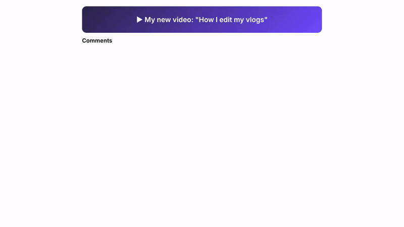
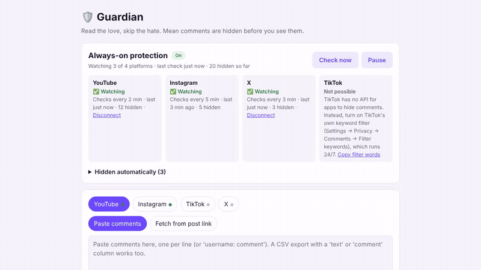
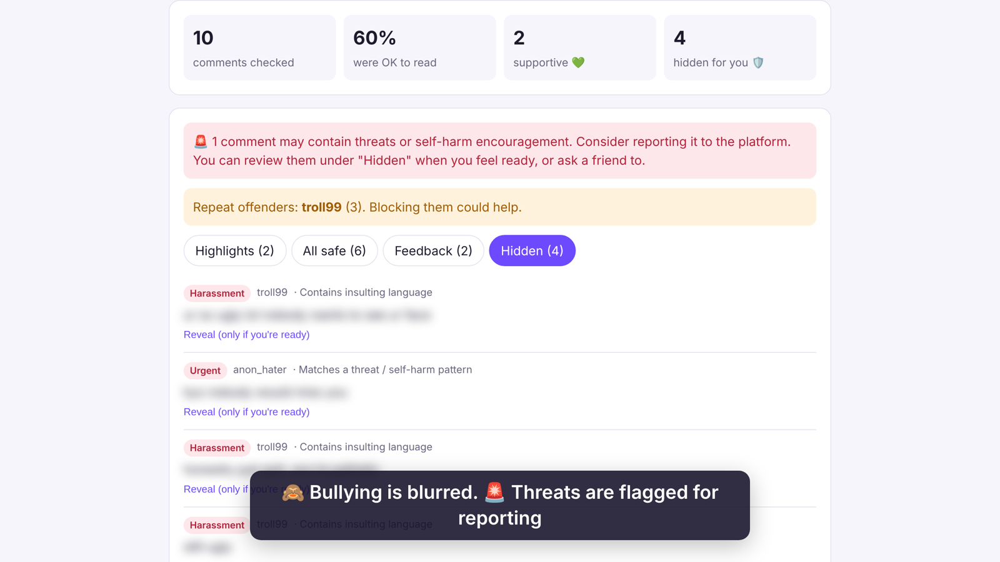
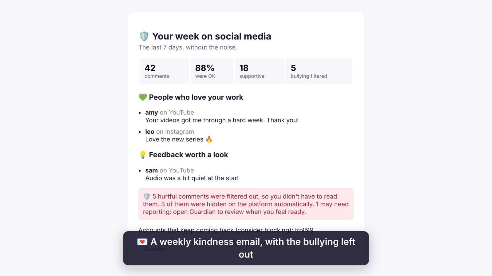

<div align="center">

# 🛡️ Guardian

### Read the love. Skip the hate.

**A free, open-source comment shield for creators.** Guardian hides bullying on YouTube, Instagram and X
around the clock, blurs it on TikTok, and puts your kind comments first. Try it in one command.

[](https://github.com/swetha-8219/Guardian/actions/workflows/tests.yml)
[](LICENSE)
[](pyproject.toml)
[](#-use-it-from-claude-mcp)
[](https://github.com/swetha-8219/Guardian/stargazers)

**[▶️ Try it in your browser](https://swetha-8219.github.io/Guardian/)** ·
**[🎬 Watch the 55-sec demo](docs/guardian-demo.mp4)** ·
**[⚡ Quick start](#-quick-start-30-seconds)**



</div>

---

Anonymous accounts can drop cruel comments on any post, and creators read every one. Paid
moderation tools cost hundreds or thousands of dollars a year, and the built-in filters only match
keywords on one platform at a time. **Guardian is free, works across four platforms, and is built
around the creator's mental health, not brand safety.**

> ⭐ **If Guardian helps you or a creator you care about, please star the repo.** It's how other
> creators find it.

## ⚡ Quick start (30 seconds)

```bash
# with uv: nothing else to install first
uvx --from git+https://github.com/swetha-8219/Guardian guardian
```

Or with pip:

```bash
pip install git+https://github.com/swetha-8219/Guardian
guardian
```

Guardian opens in your browser. Click **Try sample comments**, then **Shield my comments**.
**No keys or accounts needed** to try it. Connect your platforms when you want
always-on protection.

## ✨ What it does



| | Feature | What it means for you |
|---|---|---|
| ⏱️ | **Always-on protection** | Hides bullying **on the platform itself**: YouTube every 2 min, X every 3, Instagram every 5. No clicking needed. One click on **Unhide** if it gets one wrong. |
| 💚 | **Kind comments first** | A highlights feed of supportive comments. Honest feedback ("audio was quiet") stays visible, because criticism isn't bullying. |
| 🙈 | **Blurred, not shown** | Hurtful comments are blurred. You only read them if *you* choose to. |
| 🚨 | **Threat alerts & evidence** | Threats and self-harm encouragement are flagged, repeat offenders are named, and a CSV export lets you report without rereading. |
| 🧩 | **Browser extension** | Blurs hurtful comments as you scroll **YouTube, Instagram, TikTok and X**. |
| 💌 | **Weekly kindness email** | A summary of the good parts of your week. The hate is never in it. |
| 🤖 | **Works with Claude (MCP)** | Ask Claude *"how did people react to my latest video?"* and get the love and the feedback, not the abuse. |
| 🧠 | **Understands context** | With an Anthropic API key, Claude sorts comments and catches sarcasm and spellings like "k!ll urself". Without one, a built-in word filter works offline. |

<table>
<tr>
<td></td>
<td></td>
</tr>
</table>

## 🆚 Why Guardian?

| | **Guardian** | Built-in platform filters | Paid moderation tools (Bodyguard, NapoleonCat, Respondology…) |
|---|---|---|---|
| Price | **Free, MIT-licensed** | Free | Often hundreds to thousands of $ a year |
| Platforms | **YouTube, Instagram, X + TikTok (blur)** | One platform each | Several, varies by tool |
| Understands sarcasm & creative spelling | **Yes, with Claude** | Mostly keyword lists | Yes |
| Built for the creator's wellbeing (highlights, blur, kindness email) | **Yes** | No | Mostly brand safety |
| Your data stays with you (self-hosted) | **Yes** | n/a | No, it's their cloud |
| Works with Claude / AI agents (MCP) | **Yes** | No | No |
| Human moderators, 24/7 support | No | No | **Some do** |

Guardian is the right fit for individual creators and small teams. If you're a big brand that needs
human moderators and an SLA, a paid tool is worth a look.

## 🔍 How it works

1. **Reads comments.** Through each platform's official API, with your permission. You log in once,
   and the login stays on your own computer. (TikTok doesn't share comments with apps, so there
   Guardian works through the browser extension or pasted comments.)
2. **Sorts every comment** into *supportive, neutral, feedback, harassment* or *threat*, using Claude
   if you add a key, or the offline word filter if you don't.
3. **Hides harassment and threats** on the platform: *held for review* on YouTube, *hidden* on
   Instagram, *hidden replies* on X. **Nothing is ever deleted**, and everything can be undone.
4. **Shows you the good stuff** first, and keeps a blurred record of what it hid.

## 🤖 Use it from Claude (MCP)

Guardian is also an [MCP](https://modelcontextprotocol.io) server with three tools: `sort_comments`,
`check_post` and `always_on_status`. Claude is told to lead with the kind comments and useful
feedback, and not to repeat the hate unless you ask.

**Claude Code:**

```bash
claude mcp add guardian -- uvx --from "creator-guardian[mcp] @ git+https://github.com/swetha-8219/Guardian" guardian-mcp
```

**Claude Desktop** (`claude_desktop_config.json`):

```json
{
  "mcpServers": {
    "guardian": {
      "command": "uvx",
      "args": ["--from", "creator-guardian[mcp] @ git+https://github.com/swetha-8219/Guardian", "guardian-mcp"],
      "env": { "YOUTUBE_API_KEY": "your-key", "ANTHROPIC_API_KEY": "optional" }
    }
  }
}
```

Then ask: *"Check the comments on https://youtu.be/… and tell me what people liked."*

---

## 📖 Setup guide

Everything below is optional. Guardian works out of the box with pasted comments. Settings go
in a `.env` file in the folder you run Guardian from. Copy [`.env.example`](.env.example) to start.

### Smarter sorting with Claude (recommended)

The offline filter only matches words, so it misses sarcasm ("nice glasses, grandma"). Add an
Anthropic API key and comments are sorted by Claude, which can tell *"your argument is wrong"*
(feedback) from *"you're stupid"* (harassment):

```
ANTHROPIC_API_KEY=sk-ant-...
```

Get a key at <https://console.anthropic.com>. Comments are sent in batches of 40 at low effort to
keep it fast and cheap. Set `GUARDIAN_MODEL` to use a different model. If the AI is ever
unavailable, Guardian quietly falls back to the offline filter.

### Connecting each platform

You can always **paste** comments or **upload a CSV/TXT**. To fetch comments from a post link:

| Platform | Add to `.env` | How to get it | What to paste in the app |
|---|---|---|---|
| **YouTube** | `YOUTUBE_API_KEY` | Free. [Google Cloud Console](https://console.cloud.google.com/) → New project → enable **YouTube Data API v3** → Credentials → API key | Video link |
| **Instagram** | `INSTAGRAM_ACCESS_TOKEN` | Needs a **Business or Creator** account linked to a Facebook Page. Create an app at [developers.facebook.com](https://developers.facebook.com/), then get a token in the Graph API Explorer with `instagram_basic` + `instagram_manage_comments` | The post's numeric **media ID** (`GET /me/accounts`, then `GET /{ig-user-id}/media` in the Explorer) |
| **X** | `X_BEARER_TOKEN` | [developer.x.com](https://developer.x.com/). Reading replies needs the **Basic** tier or higher (paid) | Post link |
| **TikTok** | *nothing* | TikTok has no comments API, so **paste or upload** them. `username: comment` lines keep the username. | n/a |

### ⏱️ Always-on protection

Once an account is connected, Guardian checks for new comments every few minutes and hides
harassment and threats **on the platform**. It starts automatically with `guardian`. The
**Always-on protection** panel shows what it's doing and has a **Pause** button.

| Platform | Checks every | What it watches | What hiding does | Connect it |
|---|---|---|---|---|
| **YouTube** | 2 min | Newest 100 comments across your channel | *Held for review* (approve in YouTube Studio to undo) | **Connect YouTube** (below) |
| **Instagram** | 5 min | Comments on your 10 latest posts | *Hidden* | `INSTAGRAM_ACCESS_TOKEN` with `instagram_manage_comments` |
| **X** | 3 min | New replies to you | *Hidden replies* | **Connect X** (below) |
| **TikTok** | n/a | TikTok has no API for this | Use TikTok's own keyword filter | **Copy filter words** in the panel |

Intervals follow each platform's rate limits. Change them with `GUARDIAN_YOUTUBE_INTERVAL`,
`GUARDIAN_INSTAGRAM_INTERVAL` or `GUARDIAN_X_INTERVAL` (seconds, minimum 30). Wrongly hidden?
Open *Hidden automatically* in the panel and click **Unhide**.

<details>
<summary><b>One-time YouTube login setup</b></summary>

1. In [Google Cloud Console](https://console.cloud.google.com/), in the same project as your API key,
   open **APIs & Services → OAuth consent screen**. Choose *External* and add yourself as a test user.
2. **Credentials → Create credentials → OAuth client ID → Web application.** Add the redirect URI
   `http://localhost:5000/auth/youtube/callback`.
3. Put the client ID and secret in `.env` as `YOUTUBE_CLIENT_ID` and `YOUTUBE_CLIENT_SECRET`.
4. Restart Guardian and click **Connect YouTube**. The login is saved in `.tokens.json` on your
   computer (git-ignored). You can only hide comments on your own channel's videos.
</details>

<details>
<summary><b>One-time X login setup</b></summary>

Reading replies needs the X API **Basic** tier or higher.

1. At [developer.x.com](https://developer.x.com/), open your app → **User authentication settings** →
   turn on **OAuth 2.0** with *Read and write* permissions.
2. Add the callback URL `http://localhost:5000/auth/x/callback`.
3. Put the **Client ID** (and Client Secret, if your app type has one) in `.env` as `X_CLIENT_ID` /
   `X_CLIENT_SECRET`.
4. Restart Guardian and click **Connect X**. X only lets you hide replies in conversations you
   started. Anything it can't hide is listed in the panel.
</details>

<details>
<summary><b>TikTok: the next best thing</b></summary>

TikTok doesn't let apps read or hide comments, so no tool can do it automatically. TikTok's own
keyword filter also runs 24/7: in the Always-on protection panel, click **Copy filter words**, then
in TikTok go to **Settings and privacy → Privacy → Comments → Filter keywords** and paste them. The
browser extension also blurs bullying while you scroll TikTok.
</details>

#### Keeping it running 24/7

Always-on protection only works while Guardian is running. If your computer sleeps, it catches up on
missed comments when it starts again. For true 24/7, run just the always-on part on a server. Log in
once on your computer first (so `.tokens.json` exists), then copy the project, `.env` and
`.tokens.json` to the server:

```bash
docker build -t guardian .
docker run -d --restart unless-stopped --env-file .env \
  -v "$PWD/.tokens.json:/app/.tokens.json" -v "$PWD/guardian-data:/data" guardian
```

Without Docker, `guardian-always-on` does the same (`--once` checks once and shows each platform's
status). Run it in the app **or** on a server, not both. Set `ALWAYS_ON=off` in the app's `.env`
if you use a server.

### 🧩 Browser extension (all 4 platforms)

1. Download this repo ([ZIP](https://github.com/swetha-8219/Guardian/archive/refs/heads/main.zip)) and unzip it.
2. Go to `chrome://extensions` (Chrome, Edge, Brave) and switch on **Developer mode**.
3. Click **Load unpacked** and choose the `extension` folder.
4. Pin the 🛡️ Guardian icon. Its popup turns blurring on/off and shows how many comments were
   hidden on the page.

For **smarter AI sorting**, run `guardian` with `ANTHROPIC_API_KEY` set and tick *Smarter AI
sorting* in the popup. Sites change their layouts sometimes. If blurring stops on one, update its
selector at the top of `extension/content.js`.

### 💌 Weekly kindness email

1. In `.env`, set `WATCH_POSTS` (e.g. `youtube:https://youtu.be/abc, instagram:1789..., x:https://x.com/me/status/123`),
   `REPORT_TO`, and the `SMTP_...` settings. For Gmail: `smtp.gmail.com`, port `587`, and an
   [App password](https://myaccount.google.com/apppasswords). `AUTO_HIDE=true` also hides new bullying.
2. Preview: `guardian-weekly-report --preview` writes `kindness-report.html`.
3. Send: `guardian-weekly-report`. Schedule it weekly with cron (`0 9 * * 1 cd /your/folder && guardian-weekly-report`)
   or Windows Task Scheduler.

---

## 🗺️ Roadmap

- [ ] Word lists in more languages (Spanish, Hindi, Portuguese…)
- [ ] Twitch chat and Bluesky support
- [ ] Firefox extension
- [ ] Instant hiding on Instagram via webhooks (instead of every 5 min)
- [ ] One-click cloud deploy

Ideas? [Open a feature request](https://github.com/swetha-8219/Guardian/issues/new?template=feature_request.yml).

## 🤝 Contributing

Contributions are very welcome, especially word lists in other languages. See
[CONTRIBUTING.md](CONTRIBUTING.md) for the 2-minute dev setup and **good first issues**.
Found a comment Guardian got wrong?
[Report it here](https://github.com/swetha-8219/Guardian/issues/new?template=false_positive.yml).
It's the fastest way to make Guardian better.

## ❓ FAQ

**Is my data safe?** Guardian has no server of its own. Logins and keys stay on your computer.
Comments only go to Anthropic if you add an Anthropic key. See [SECURITY.md](SECURITY.md).

**Does it delete comments?** Never. It hides them, so every action can be undone.

**Will it hide criticism?** It's designed not to. Feedback about your work stays visible. If it hides
something it shouldn't, click **Unhide**.

**Why not TikTok auto-hide?** TikTok doesn't offer an API for it. Guardian does the next best
things: the extension blurs comments, and the panel sets you up with TikTok's own keyword filter.

## 💚 A note for creators

What strangers type says more about them than about you. If comments are affecting you, step away,
talk to someone you trust, and in a crisis contact a local helpline.

---

<div align="center">

**MIT licensed** · Made to make the internet a little kinder ·
**[⭐ Star Guardian on GitHub](https://github.com/swetha-8219/Guardian)** if it helped you

</div>
